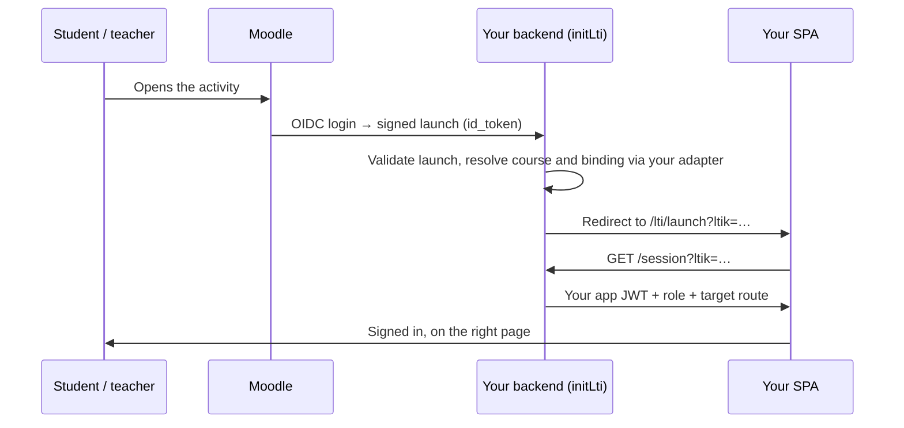

# lti-moodle-integration

[](https://github.com/carsonhung/lti-moodle-integration/actions/workflows/ci.yml)
[](LICENSE)


**Make your Express app an LTI 1.3 tool that Moodle (or any LTI LMS) can launch —
with teacher activity picking, grade passback, and ready-made Vue 3 and React 18
screens.**

LTI is how an LMS such as Moodle, Canvas, or Brightspace opens an external app
for a signed-in student or teacher. [`ltijs`](https://github.com/Cvmcosta/ltijs)
handles the protocol; this module adds the application layer you would otherwise
build yourself: turning a launch into your app's session, letting teachers bind
an activity to your content, pushing grades back reliably, and the UI for all of
it. You plug in your database and auth through one adapter interface.

Used in production by HKU TALIC projects, including the TALIC Chatbot.

## Features

| | |
|---|---|
| **Launch → app session** | OIDC login and launch validation, then an exchange of the LTI token for *your* app's JWT, so your SPA authenticates as usual. |
| **Three connect modes** | `login-only` (LMS as SSO, 3-method adapter), `context-mapping` (Moodle course → your course), or `deep-linking` (teachers pick content). |
| **Deep Linking** | Teachers pick a course plus a resource, a category of resources, or a **graded assignment** that creates the Moodle grade column. |
| **Grade passback** | One `sendScore()` for LTI 1.3 AGS and LTI 1.1 Basic Outcomes. AGS is a durable, idempotent sync with retries, score policies, and recovery when Moodle's line item has gone. |
| **Vue 3 and React 18 UI** | Launch, deep-link picker, and platform-admin screens in both frameworks, sharing one framework-neutral API client. |
| **Any database** | Adapter pattern — Mongoose, Drizzle/Postgres, Prisma, Supabase. ltijs state in MongoDB or SQL via [`ltijs-sequelize`](https://www.npmjs.com/package/ltijs-sequelize). |
| **Legacy LMS support** | Optional LTI 1.0a / 1.1 launches (OAuth 1.0a) with Content-Item deep linking, alongside 1.3. |
| **Multi-tenant aware** | Tenant resolution, auto-mapping of courses, and auto-enrollment are built in and optional. |

## How a launch works



## Quick start

**1. Install**

```bash
npm install git+https://github.com/carsonhung/lti-moodle-integration.git#v1.2.0
```

> Recent npm versions block install scripts from git dependencies, and this
> package compiles itself in `prepare`. If `node_modules/lti-moodle-integration/backend/dist`
> is missing after install, run `npm approve-scripts lti-moodle-integration` and
> reinstall. Always pin a tag or commit.

**2. Implement an adapter and mount the routes**

The smallest setup is login-only mode: three methods, and Moodle becomes a
sign-in provider for your app.

```ts
import express from 'express';
import { initLti, type LtiLoginOnlyAdapter } from 'lti-moodle-integration/backend';

const adapter: LtiLoginOnlyAdapter = {
  customFieldPrefix: 'myapp',
  upsertUser: async ({ email, name, role }) => findOrCreateUser({ email, name, role }),
  generateJwt: (user) => signAppJwt(user), // returns { token, expiresIn }
  resolveEffectiveTenant: () => undefined,
};

const app = express();
await initLti(app, adapter, {
  mountPath: '/api/lti',
  connectMode: 'login-only',
  loginOnlyLaunchPath: '/lti/launch', // SPA route that calls /api/lti/session
  ltiaas: true,                       // avoids third-party-cookie problems in iframes
});
app.listen(3000);
```

**3. Configure and register in Moodle**

Set `LTI_ENABLED`, `LTI_ENCRYPTION_KEY`, `LTI_DB_URL`, and the `LTI_PLATFORM_*`
values (all listed in [`.env.example`](.env.example)), then add the tool in Moodle
using [docs/MOODLE_SETUP.md](docs/MOODLE_SETUP.md).

**Try it:** [`examples/login-only-express`](examples/login-only-express) is a
complete, runnable version of the above in one file.

For teacher activity selection and grade passback, implement the full
`LtiAdapter` — reference Mongoose and Drizzle adapters are included. Walkthrough:
[docs/GETTING_STARTED.md](docs/GETTING_STARTED.md).

## Grade passback in one call

```ts
import { sendScore } from 'lti-moodle-integration/backend';

await sendScore({
  platform: { issuer, clientId, deploymentId, contextId }, // recorded at launch
  resourceLinkId,
  userExternalId: platformSubject, // LTI `sub` (1.3) or user_id (1.1)
  scoreGiven: 8,
  scoreMaximum: 10,
  scorePolicy: 'highest',
});
```

Details, durable stores, and graded-assignment deep links:
[docs/GRADE_PASSBACK.md](docs/GRADE_PASSBACK.md).

## The adapter

The core never imports a database driver. Everything project-specific goes
through the `LtiAdapter` interface (`backend/src/types.ts`):

| Concern | Methods |
|---|---|
| Users | `resolveTeacherByEmail`, `resolveOrProvisionTeacher`, `upsertUser`, `generateJwt` |
| Courses | `listCoursesForTeacher`, `getCourseForTeacher`, `getCourseById`, `suggestCourses`, `findCourseByCourseId(ForTeacher)` |
| Content | `listSelectableResources`, `getSelectableResourceForDeepLinking`, plus optional category and assignment methods |
| Enrollment | `ensureResourceInCourse`, `ensureTeacherInCourse`, `ensureStudentInCourse` |
| Mapping | `findCourseMap`, `upsertCourseMap`, `findResourceBinding`, `upsertResourceBinding` |
| Tenants | `resolveEffectiveTenant`, `resolveTenantFromBinding`, `grantTeacherTenantAccess`, `getTenantMode?` |

Login-only deployments implement just `LtiLoginOnlyAdapter` (3 methods).
Reference implementations: `backend/src/adapters/*.example.ts`.

## Documentation

| Guide | Covers |
|---|---|
| [Getting started](docs/GETTING_STARTED.md) | Step-by-step setup: backend, adapter, frontend, environment, first launch |
| [Ways to consume the package](docs/INSTALLATION.md) | Copy in, reference in place, or install as a package |
| [Moodle setup](docs/MOODLE_SETUP.md) | Registering the external tool in Moodle, including AGS settings |
| [Login-only mode](docs/LOGIN_ONLY.md) | LMS as SSO, identity resolution, host-delegated content selection |
| [Grade passback](docs/GRADE_PASSBACK.md) | `sendScore()`, AGS sync and recovery, graded assignment deep links |
| [React components](docs/REACT.md) | Using the React 18 screens instead of Vue |
| [SQL deployments](docs/SQL_DEPLOYMENTS.md) | Running ltijs on Postgres / MySQL / SQLite |
| [LTI 1.0a / 1.1](docs/LEGACY_LTI11.md) | Legacy LMS launches, consumer store, Basic Outcomes |
| [Central broker](docs/BROKER.md) | Consuming launches through a central LTI broker |
| [Architecture](docs/ARCHITECTURE.md) | Module design and request flows |
| [Integration manual](docs/LTI_INTEGRATION_MANUAL.md) | End-to-end reference, environment variables, troubleshooting |
| [Integration template](docs/INTEGRATION_TEMPLATE.md) | Fill-in template for each deployment shape (useful with AI coding agents) |

## Compatibility

- **Moodle** 3.7+ (any version with LTI 1.3) — used in production.
- Other LTI 1.3 platforms (Canvas, Brightspace, Blackboard, Sakai) should work
  through the same standard flows. If you try one, please file an
  [LMS compatibility report](https://github.com/carsonhung/lti-moodle-integration/issues/new?template=lms_compatibility.yml).
- Node 22+, Express 4 (Express 5 hosts work with a one-line type cast).

## Contributing

Issues and pull requests are welcome — see [CONTRIBUTING.md](CONTRIBUTING.md).
Please report security issues privately as described in [SECURITY.md](SECURITY.md).
Release notes are in [CHANGELOG.md](CHANGELOG.md).

## License

Licensed under the [Apache License 2.0](LICENSE), Copyright 2026 Dr. Carson Hung —
see [`NOTICE`](NOTICE). An independent community project, used in HKU TALIC
projects including the TALIC Chatbot.
