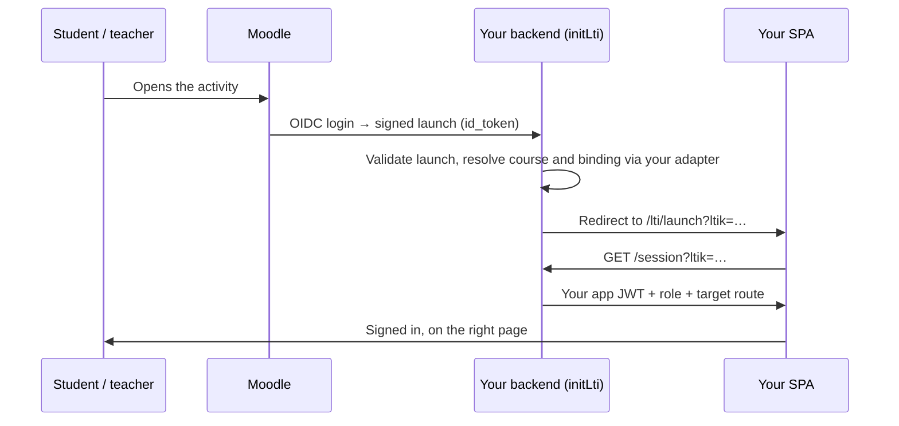

# lti-moodle-integration

[](https://www.npmjs.com/package/lti-moodle-integration)
[](https://github.com/carsonhung/lti-moodle-integration/actions/workflows/ci.yml)
[](LICENSE)


**Make your Express app an LTI 1.3 tool that Moodle (or any LTI LMS) can launch —
with teacher activity picking, grade passback, and ready-made Vue 3 and React 18
screens.**

Used in production by HKU TALIC projects, including the TALIC Chatbot.

## What problem does this solve?

You have a web app (an Express backend and a single-page frontend) and you want
it to appear *inside* Moodle courses. Ideally:

- A student clicks an activity in Moodle and lands in your app **already signed
  in**, with no second login and no separate account to create.
- A teacher adding the activity can **choose which part of your app** it opens
  (a course, a quiz, a chatbot, …).
- Scores earned in your app show up in the **Moodle gradebook**.

LTI (Learning Tools Interoperability) is the standard that makes this possible,
and LTI 1.3 is its current, signed-token version. The protocol itself (OIDC
login, signature checks, key sets) is handled by
[`ltijs`](https://github.com/Cvmcosta/ltijs). What `ltijs` does *not* give you is
the application layer on top, and that is what this package provides:

- turning a verified launch into **your app's own session** (your JWT, your user
  record);
- letting teachers **bind an activity to your content**;
- **pushing grades back** reliably, with retries;
- the **frontend screens** for all of the above, in Vue 3 and React 18.

Your database and auth stay yours. The package talks to them only through one
adapter interface that you implement.

## Key terms

If you're new to LTI, these words come up throughout the docs:

| Term | Meaning |
|---|---|
| **Platform** | The LMS doing the launching — Moodle, Canvas, Brightspace, etc. |
| **Tool** | Your app, the thing being launched. |
| **Launch** | A student or teacher opening your tool from the LMS. The LMS sends a signed token (`id_token`) saying who they are, what course they're in, and their role. |
| **`ltik`** | A short-lived launch key that `ltijs` gives your frontend after a valid launch. Your SPA swaps it for your own app JWT at `/session`. |
| **Deep Linking** | An LTI flow where the teacher picks content from your tool while creating the Moodle activity, so later launches open that exact content. |
| **AGS** | Assignment and Grade Services, the LTI 1.3 API for sending scores to the LMS gradebook. |
| **Adapter** | The object you write that connects this package to your database and auth (find or create users, issue JWTs, list courses, …). |

## Features

| | |
|---|---|
| **Launch → app session** | OIDC login and launch validation, then an exchange of the LTI token for *your* app's JWT, so your SPA authenticates as usual. |
| **Three connect modes** | `login-only` (LMS as SSO, 3-method adapter), `context-mapping` (Moodle course → your course), or `deep-linking` (teachers pick content). |
| **Deep Linking** | Teachers pick a course plus a resource, a category of resources, or a **graded assignment** that creates the Moodle grade column. |
| **Grade passback** | One `sendScore()` for LTI 1.3 AGS and LTI 1.1 Basic Outcomes. AGS is a durable, idempotent sync with retries, score policies, and recovery when Moodle's line item has gone. |
| **Vue 3 and React 18 UI** | Launch, deep-link picker, and platform-admin screens in both frameworks, sharing one framework-neutral API client. |
| **Any database** | Adapter pattern — Mongoose, Drizzle/Postgres, Prisma, Supabase. ltijs state in MongoDB or SQL via [`ltijs-sequelize`](https://www.npmjs.com/package/ltijs-sequelize). |
| **Legacy LMS support** | Optional LTI 1.0a / 1.1 launches (OAuth 1.0a) with Content-Item deep linking, alongside 1.3. |
| **Multi-tenant aware** | Tenant resolution, auto-mapping of courses, and auto-enrollment are built in and optional. |

## Which connect mode do I need?

The `connectMode` option decides what happens after a launch and how much of the
adapter you implement. Start with `login-only` if you only need sign-in; you can
move to a richer mode later. Only `deep-linking` needs an extra Moodle setting
("Supports Deep Linking"), described in [Moodle setup](docs/MOODLE_SETUP.md).

| Mode | What users experience | What you implement |
|---|---|---|
| `login-only` | Moodle works as a sign-in button. Everyone lands in your app signed in, on a page you choose. | `LtiLoginOnlyAdapter`: 3 methods. |
| `context-mapping` | The Moodle course is linked to a course in your app. Teachers manage content in your app; students pick what to open. No Deep Linking needed. | Full `LtiAdapter`. |
| `deep-linking` | When adding the activity, the teacher picks the exact content (or a graded assignment) in your app's picker. Each activity then opens that content directly. | Full `LtiAdapter` + the deep-link screen. |

## How a launch works



In plain terms:

1. The user clicks the activity in Moodle. Moodle and your backend run a short
   OIDC handshake, and Moodle posts a signed `id_token` to your `/launch`
   endpoint.
2. Your backend (via `ltijs`) checks the signature against Moodle's public keys,
   then calls your adapter to work out who the user is and which course or
   content the activity points to.
3. The browser is redirected to your SPA's launch route with an `ltik` in the URL.
   No app session exists yet, so this route must be public.
4. The launch screen calls `/session?ltik=…`. Your adapter's `upsertUser` and
   `generateJwt` run, and the SPA receives **your own JWT** plus where to send
   the user.
5. From here the SPA behaves exactly as if the user had logged in normally. LTI
   isn't involved again until the next launch, or until you send a grade.

## Quick start

This walks through the smallest setup, `login-only` mode, where Moodle becomes a
sign-in provider for your app.

**Before you start, you need:**

- Node 22+ and an Express 4 app.
- MongoDB, where `ltijs` keeps its own state: registered platforms, nonces and
  keys. It can be the same database as your app. On SQL, see
  [SQL deployments](docs/SQL_DEPLOYMENTS.md).
- A public **HTTPS** URL Moodle can reach. For local testing, use a tunnel such as
  `cloudflared tunnel --url http://localhost:3000` or `ngrok http 3000`.
- Admin access to a Moodle site, so you can register the tool.

### 1. Install

```bash
npm install lti-moodle-integration
```

The backend ships compiled with type definitions; the Vue and React components
ship as source for your bundler. Other ways to use it (copying the source in, or
installing from a git tag) are in [docs/INSTALLATION.md](docs/INSTALLATION.md).

### 2. Implement the adapter and mount the routes

```ts
import express from 'express';
import { initLti, type LtiLoginOnlyAdapter } from 'lti-moodle-integration/backend';

const adapter: LtiLoginOnlyAdapter = {
  // Prefix for custom launch parameters (e.g. myapp_course_id). Keep it stable.
  customFieldPrefix: 'myapp',
  // Called on every launch with the verified identity from Moodle.
  // Find the user in your database, or create them on first launch.
  upsertUser: async ({ email, name, role }) => findOrCreateUser({ email, name, role }),
  // Issue the same kind of session token your normal login issues.
  generateJwt: (user) => signAppJwt(user), // returns { token, expiresIn }
  // Single-tenant apps return undefined.
  resolveEffectiveTenant: () => undefined,
};

const app = express();
await initLti(app, adapter, {
  mountPath: '/api/lti',              // all LTI endpoints live under this path
  connectMode: 'login-only',
  loginOnlyLaunchPath: '/lti/launch', // SPA route that calls /api/lti/session
  ltiaas: true,                       // passes state in the URL, not cookies (see below)
});
app.listen(3000);
```

`initLti` adds these endpoints under `mountPath`:

| Endpoint | Used by | Purpose |
|---|---|---|
| `/login` | Moodle | Starts the OIDC handshake (Moodle's "Initiate login URL"). |
| `/launch` | Moodle | Receives the signed launch (Moodle's "Tool URL" and "Redirection URI"). |
| `/keys` | Moodle | Your tool's public key set (Moodle's "Public keyset"). |
| `/session` | Your SPA | Exchanges an `ltik` for your app JWT. |

Why `ltiaas: true`: Moodle usually shows tools inside an iframe, and modern
browsers block third-party cookies there. With this option `ltijs` keeps launch
state in the URL instead, so launches work in every browser. Keep it on unless you
have a specific reason not to.

`initLti` does nothing unless `LTI_ENABLED=true`, so you can ship the code and
switch LTI on per environment.

### 3. Add the launch screen to your frontend

Your SPA needs a **public** route at `loginOnlyLaunchPath` that swaps the `ltik`
for your JWT. Use the provided screen, and point the API client at the same
`mountPath` as the backend:

```ts
import { configureLtiApi } from 'lti-moodle-integration/frontend/src/api';
import LtiLaunchView from 'lti-moodle-integration/frontend/src/views/LtiLaunchView.vue';
// React: import { LtiLaunch } from 'lti-moodle-integration/frontend/src/react/LtiLaunch';

configureLtiApi({ ltiBase: '/api/lti' }); // must match the backend mountPath

// Vue Router — no auth guard on this route; it is what creates the session.
{ path: '/lti/launch', name: 'LtiLaunch', component: LtiLaunchView, meta: { public: true } }
```

The launch screen stores the token in `localStorage` by default. Edit its marked
integration hooks to use your own auth store instead. Ready-made route lists are
in [`frontend/src/router-integration.example.ts`](frontend/src/router-integration.example.ts)
(Vue) and [`frontend/src/react/routes-integration.example.tsx`](frontend/src/react/routes-integration.example.tsx)
(React).

### 4. Configure and register in Moodle

Copy [`.env.example`](.env.example) and set at least:

- `LTI_ENABLED=true`
- `LTI_ENCRYPTION_KEY`: a stable random string `ltijs` uses to encrypt platform
  credentials. If it changes, existing registrations can no longer be read.
- `LTI_DB_URL`: MongoDB connection string for `ltijs`.
- `APP_URL`: your public HTTPS URL.

Then register the tool in Moodle (**Site administration › Plugins › Activity
modules › External tool › Manage tools**) using the URLs from the endpoint table
above. Moodle then shows a client ID and its own endpoints. Copy them into the
`LTI_PLATFORM_*` variables so your backend trusts this Moodle, then restart.
Field-by-field instructions are in [docs/MOODLE_SETUP.md](docs/MOODLE_SETUP.md).

### 5. Try it

Add the tool as an activity in a Moodle course and open it. You should land in
your app, signed in.

**Want a working reference first?**
[`examples/login-only-express`](examples/login-only-express) is a complete,
runnable version of this quick start in one file.

**Next:** for teacher content selection and grade passback, implement the full
`LtiAdapter` and switch to `context-mapping` or `deep-linking`. Reference
Mongoose and Drizzle adapters are included, and
[docs/GETTING_STARTED.md](docs/GETTING_STARTED.md) walks through it.

## Grade passback in one call

When a student finishes something gradable in your app, call `sendScore()`. It
works for both LTI 1.3 (AGS) and LTI 1.1 launches. The platform and resource link
values are the ones recorded when the student launched.

```ts
import { sendScore } from 'lti-moodle-integration/backend';

await sendScore({
  platform: { issuer, clientId, deploymentId, contextId }, // recorded at launch
  resourceLinkId,
  userExternalId: platformSubject, // LTI `sub` (1.3) or user_id (1.1)
  scoreGiven: 8,
  scoreMaximum: 10,
  scorePolicy: 'highest',          // keep the student's best score
});
```

AGS must be switched on in both places: set `LTI_AGS_ENABLED=true`, and in
Moodle set the tool's "IMS LTI Assignment and Grade Services" option to grade
sync and column management. Durable stores, retries, and graded-assignment
deep links are covered in [docs/GRADE_PASSBACK.md](docs/GRADE_PASSBACK.md).

## The adapter

The core never imports a database driver. Anything specific to your project
goes through the `LtiAdapter` interface (`backend/src/types.ts`). Each method
answers one question the LTI flow needs answered, for example "who is this
teacher in my app?", "which courses can they see?" or "remember that this Moodle
activity points to resource X".

| Concern | Methods |
|---|---|
| Users | `resolveTeacherByEmail`, `resolveOrProvisionTeacher`, `upsertUser`, `generateJwt` |
| Courses | `listCoursesForTeacher`, `getCourseForTeacher`, `getCourseById`, `suggestCourses`, `findCourseByCourseId(ForTeacher)` |
| Content | `listSelectableResources`, `getSelectableResourceForDeepLinking`, plus optional category and assignment methods |
| Enrollment | `ensureResourceInCourse`, `ensureTeacherInCourse`, `ensureStudentInCourse` |
| Mapping | `findCourseMap`, `upsertCourseMap`, `findResourceBinding`, `upsertResourceBinding` |
| Tenants | `resolveEffectiveTenant`, `resolveTenantFromBinding`, `grantTeacherTenantAccess`, `getTenantMode?` |

Login-only deployments implement only `LtiLoginOnlyAdapter` (3 methods).
Reference implementations to copy from are in `backend/src/adapters/*.example.ts`.

## Documentation

| Guide | Covers |
|---|---|
| [Getting started](docs/GETTING_STARTED.md) | Step-by-step setup: backend, adapter, frontend, environment, first launch |
| [Ways to consume the package](docs/INSTALLATION.md) | Copy in, reference in place, or install as a package |
| [Moodle setup](docs/MOODLE_SETUP.md) | Registering the external tool in Moodle, including AGS settings |
| [Login-only mode](docs/LOGIN_ONLY.md) | LMS as SSO, identity resolution, host-delegated content selection |
| [Grade passback](docs/GRADE_PASSBACK.md) | `sendScore()`, AGS sync and recovery, graded assignment deep links |
| [React components](docs/REACT.md) | Using the React 18 screens instead of Vue |
| [SQL deployments](docs/SQL_DEPLOYMENTS.md) | Running ltijs on Postgres / MySQL / SQLite |
| [LTI 1.0a / 1.1](docs/LEGACY_LTI11.md) | Legacy LMS launches, consumer store, Basic Outcomes |
| [Central broker](docs/BROKER.md) | Consuming launches through a central LTI broker |
| [Architecture](docs/ARCHITECTURE.md) | Module design and request flows |
| [Integration manual](docs/LTI_INTEGRATION_MANUAL.md) | End-to-end reference, environment variables, troubleshooting |
| [Integration template](docs/INTEGRATION_TEMPLATE.md) | Fill-in template for each deployment shape (useful with AI coding agents) |

## Compatibility

- **Moodle** 3.7+ (any version with LTI 1.3) — used in production.
- Other LTI 1.3 platforms (Canvas, Brightspace, Blackboard, Sakai) should work
  through the same standard flows; `.env.example` lists each one's endpoints. If
  you try one, please file an
  [LMS compatibility report](https://github.com/carsonhung/lti-moodle-integration/issues/new?template=lms_compatibility.yml).
- Node 22+, Express 4 (Express 5 hosts work with a one-line type cast).

## Contributing

Issues and pull requests are welcome — see [CONTRIBUTING.md](CONTRIBUTING.md).
Please report security issues privately as described in [SECURITY.md](SECURITY.md).
Release notes are in [CHANGELOG.md](CHANGELOG.md).

## License

Licensed under the [Apache License 2.0](LICENSE), Copyright 2026 Dr. Carson Hung —
see [`NOTICE`](NOTICE). An independent community project, used in HKU TALIC
projects including the TALIC Chatbot.
